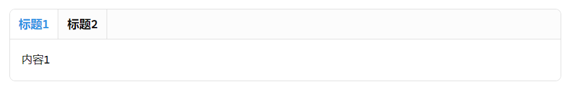
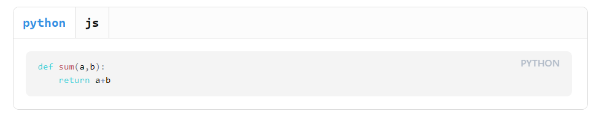
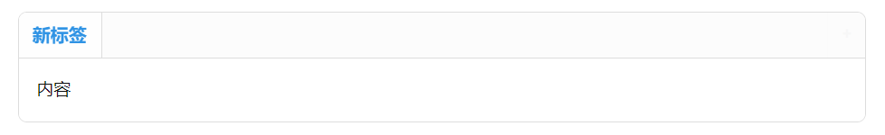
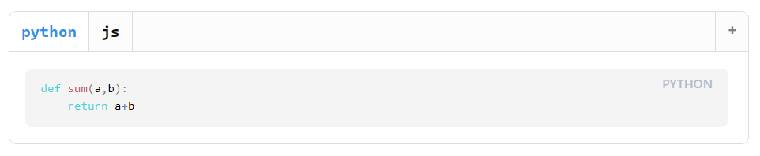
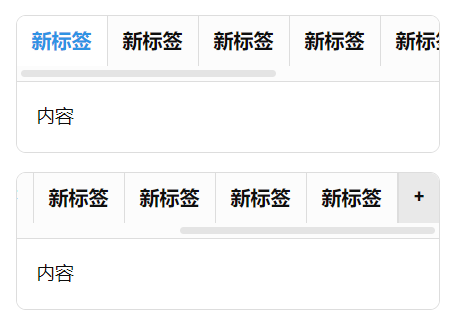
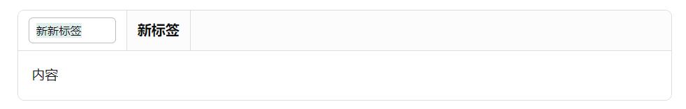
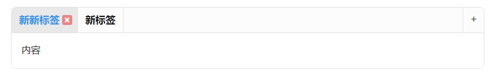
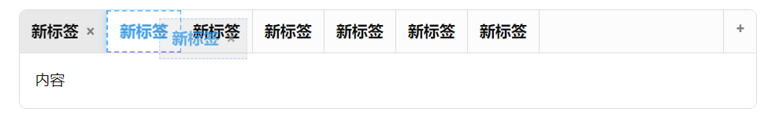
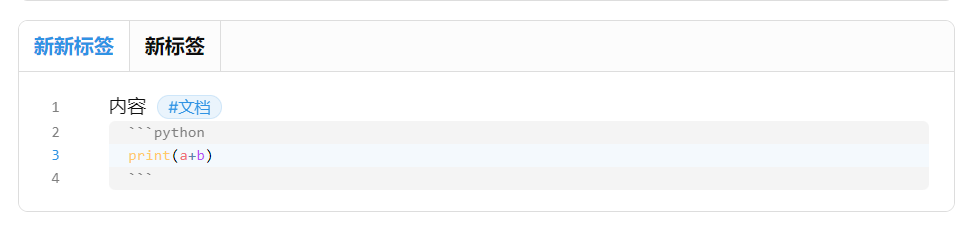
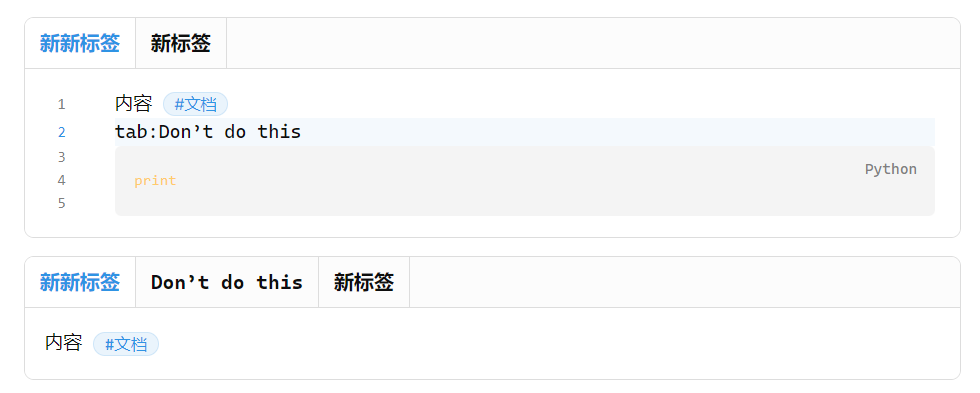

# Obsidian Code Tab

在 Obsidian 中加入可切换的标签页。

## 语法

用 `tab` 触发代码块，内部使用 `tab: 标题` 分隔每个标签。
渲染之后可任意切换 tab 以查看对应的内容。

示例

````
```tab
tab: 标题1
内容1

tab: 标题2
内容2
```
````



如果想在标签内加入代码块，应使用四个 ` 。

`````
````tab

tab: python
```python
def sum(a,b):
    return a+b
```

tab: js
```js
function sum(a, b) {
  return a + b;
}
```

````
`````



## 命令

使用 `Code Tab: 创建标签组件` 命令创建标签组件。



## 通过组件直接操作源文本

以下操作都会修改源 markdown 文本，以便在 Obsidian 中直接查看效果，如果误操作了可以进入编辑模式 Ctrl+Z 撤销。

### 创建新标签

鼠标靠近标签栏会在最右侧出现一个加号，点击即可创建新标签。



> BTW: 作者认为此组件的查看功能应该优于编辑功能，因此当标签足够多时会把添加按钮挤到后面，而不是固定显示
>
> 

### 编辑标签

双击标签文字即可编辑标签。



### 删除标签

鼠标靠近标签会出现一个删除按钮，双击（防止误操作）即可删除标签。



### 移动标签

鼠标长按标签超过 75 毫秒即可拖动标签，拖动时会出现一个虚影。



### 编辑内容

双击标签内容即可编辑内容（所见即所得！），按下 ESC 或点击内容区域外的地方即可退出编辑模式并修改源文本。



> PS: 理所应当的，如果在编辑器中间写下 `tab: 标题`，保存后会分裂成两个标签
> 
